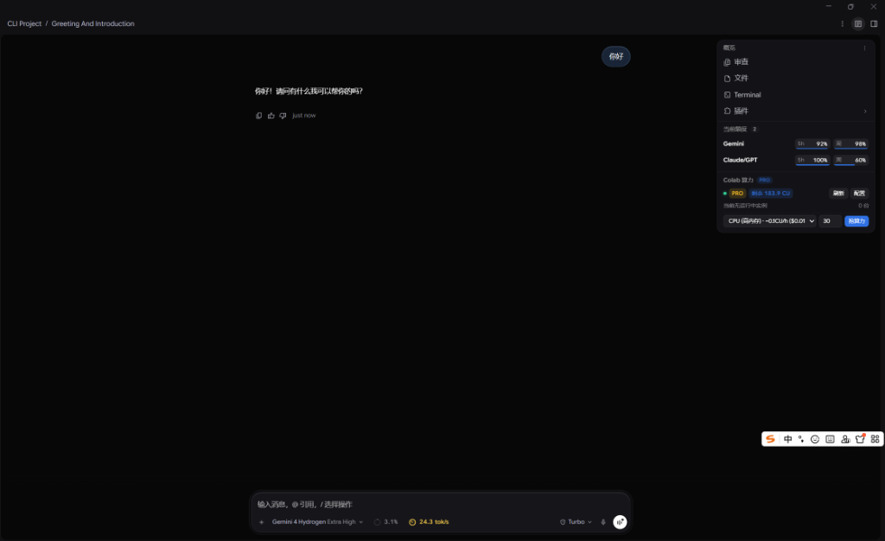

# Colab 算力面板（Antigravity 2.0 原生右侧栏插件）

基于 Antigravity 2.0 官方 UI Extension（Sidecar）规范编写，无需 Python、无需 `npm install`，直接复用 Antigravity 内置 Node.js 与 `sidecar_sdk`。



## 功能
- **OAuth 2.0 (PKCE) 一次登录**：安全对接 Google Colab API 与会话后端，一次授权即可同时获取订阅等级、精确剩余算力单元（CU）及运行中实例，Token 自动续期且仅存于本机。
- **右侧「概览」面板原生内嵌**：直接挂载在对话右侧「概览」卡片底部，实时查看剩余 CU 余额、RAM / GPU 显存与算力利用率、机房地区、运行时长与闲置倒计时，支持自动保活/手动续期及一键释放。
- **自动低频排队抢算力**：选择目标硬件配置与轮询间隔（默认 30 秒，遇 429 自动退避），分配成功后声音提醒。

## 安装方式

### 方式一：下载 Release 压缩包（最简单）
前往 [Releases 页面](https://github.com/cyscjl/agy-colab-panel/releases/latest) 下载 `agy-colab-panel.zip`，解压后将里面的 `agy-colab-panel` 文件夹复制到：
```text
%USERPROFILE%\.gemini\config\plugins\agy-colab-panel
```

### 方式二：Git 克隆
在 PowerShell 中执行：
```powershell
git clone https://github.com/cyscjl/agy-colab-panel.git "$env:USERPROFILE\.gemini\config\plugins\agy-colab-panel"
```

## 启用与打开
1. **重启 Antigravity**，让客户端扫描新插件目录。
2. 点击左侧栏 **Customizations → Installed**，确认 **Colab 算力面板**（`agy-colab-panel`）已开启。
3. 打开任意对话窗口右侧的 **概览** 面板，即可直接在底部看到 **Colab 算力** 区块（也可在右上角 **⋮ → Extensions → Colab 算力面板** 打开独立面板）。

## 首次 OAuth 凭证配置
1. 前往 [Google Cloud Console](https://console.cloud.google.com/) 选择或[新建一个项目](https://console.cloud.google.com/projectcreate)，随后直达 [**启用 Colab API (`colaboratory.googleapis.com`)**](https://console.cloud.google.com/apis/library/colaboratory.googleapis.com) 页面并点击 **启用（Enable）**（也可在 [API 库](https://console.cloud.google.com/apis/library) 中搜索 `colaboratory`）。
2. 打开 [**OAuth 同意屏幕（目标受众 / 测试用户）**](https://console.cloud.google.com/apis/credentials/consent)（用户类型选择 **外部 External**），在 **测试用户（Test users）** 中添加你自己的 Google 邮箱。
3. 打开 [**创建 OAuth 客户端 ID**](https://console.cloud.google.com/apis/credentials/oauthclient)（或在 [凭证页面](https://console.cloud.google.com/apis/credentials) 点击「创建凭证 → OAuth 客户端 ID」），应用类型选择 **桌面应用（Desktop app）**，创建后点击 **下载 JSON**（即 `client_secret.json`）。
4. 在右侧面板点击右上角 **配置**，把下载的 `client_secret.json` 全文粘贴保存（或直接将文件命名为 `client_secret.json` 放进 `%USERPROFILE%\.gemini\config\plugins\agy-colab-panel\`），随后点击 **使用 Google 账号登录** 即可（只需登录一次，即可同时显示订阅等级、剩余 CU 余额与实例状态）。

## 调试日志
如果插件未启动或报错，可查看 Antigravity 的 Sidecar 运行日志：
```text
%USERPROFILE%\.gemini\antigravity\sidecar_data\agy-colab-panel\colab\logs\sidecar.log
```
